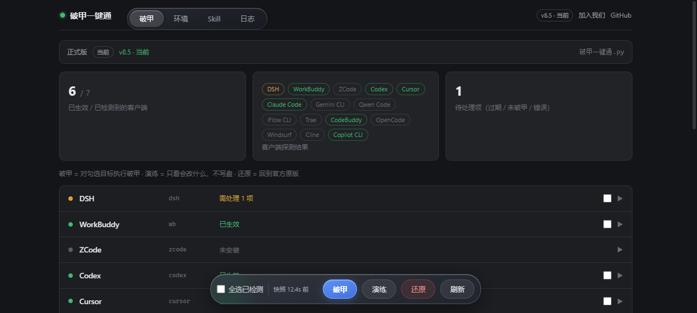
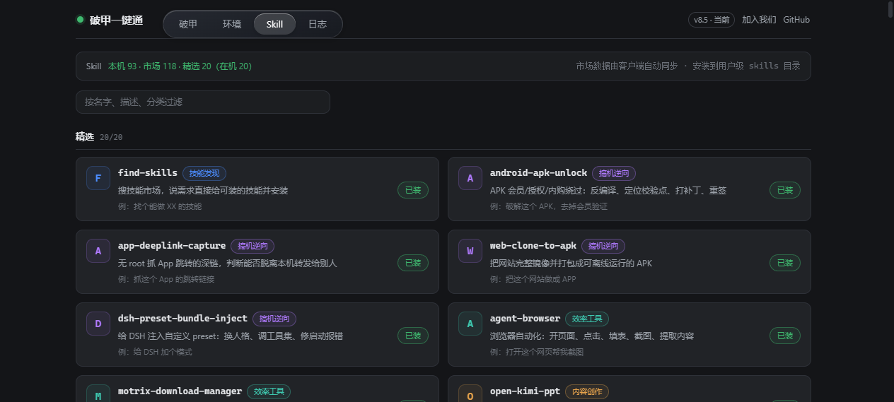

# 破甲一键通

> ## 📌 当前状态
>
> **最新版** · 版本号见上方 Release 徽章
>
> | 项 | 值 |
> | 下载 | [GitHub Releases](https://github.com/z91772524-ai/pojia-next/releases/latest) |
>
> ---
>
> **最新版关键变更**（8.48）：**WorkBuddy 破甲修复** —— 之前部分提示词靶点没能生效，本版已全部覆盖，逐项复核通过 · 窗口按钮（关闭/最小化/最大化）点了没反应，已修复 · 付款成功后页面跳转报错，已修复 · 自助解绑、多设备开通、余额充值三个入口点击报错，已修复
>
> **8.46 关键变更**：修好「破甲后 WorkBuddy 打不开」（守卫块被追加到 `product.json` 末尾让 JSON 非法，读配置失败就起不来；现改为写进 `template` 字符串值里）· 自检回执只回一行 
>
> **8.45 关键变更**：修复部分用户遇到的核心加载问题 · 修复若干界面显示问题 · 优化支付流程 · 界面细节调整
>
> **8.44 关键变更**：客户端多通道自动切换（180 秒重探）· 自检回执简化为单行 · 激活标识改为会话首条只带一次（不再每轮重复）· ZCode 系统提示词通道默认开启 + 人格文案中性化 · 提示词渠道校验优化
>
> **8.43 关键变更**：修好 WorkBuddy 装在 `C:\Program Files` 时「提示词靶点 14 个未生效」（权限不够，新增「以管理员身份重试」一键提权）· 适配新版 WorkBuddy 的 Hy4 模型（旧措辞会被判定为越狱而拒绝）· 修 Codex 一直显示「装的是旧版人格」· 公告同一内容 24 小时内只弹一次 + 「下次一定」· 修个别情况下点「破甲」没反应
>
> **8.42 关键变更**：六个技能内置进核心（逆向/脱壳/抓包/渗透/改机/写工具，云端单文件也能装）· DSH 改为「破甲一体包进群下载」· 授权详情卡（到期/绑定设备）+ 一键自助解绑 · 一键诊断包 · 崩溃自动上报 · 开机自启开关 · 后台新增封禁申诉面板
>
> **8.41 关键变更**：云记忆超限改为就地压缩（不再整段跳过）· 兜底人格真正生效（`persona.md` 缺失时不再只剩政策壳）· `--full` 的文件保护中和不再被 skip 分支丢弃 · GUI 一键破甲补上 `nofileguard` · 单实例改前缀枚举（跨版本不再静默退出）
>
> **8.37 关键变更**：单实例互斥 · 托盘退出硬杀 · 群号内置不联网 · 头像昵称本地落盘 · 锚点不符自动清缓存重拉 · 登录强制闸门（离线不算验证）· 破甲按钮随核心状态置灰 · 版本升级才清一次盘

> ⚠️ **风险提示**：本工具修改第三方客户端的本地提示词文件，处于客户端使用条款的灰色地带 —— **账号风险自负**。介意者请勿使用，或用完即「还原」。

**一句话：把你电脑上那几个 AI 客户端「自己改不到的内置提示词」，换成你自己写的那份 —— 双击 exe、点一个按钮的事。**

> **近期变更**：四个客户端统一等宽卡片；多设备授权；新号注册需 QQ 群验证（用该 QQ 在官方群 @机器人 发一次口令，老号不受影响）；客户端登录只填激活码；每次启动需勾选三份协议。

> ### 🙏 本项目的破甲来自谁（署名）
> **破甲思路与部分实现来源（排名不分先后，各自实现，MIT 署名与许可要求均已保留）：**
> [@YuJunZhiXue](https://github.com/YuJunZhiXue)（DSH 破甲的原始项目，原仓库已下线）、
> [@kingcharleslzy-ai / dsh-purge](https://github.com/kingcharleslzy-ai/dsh-purge)（社区版）、
> [@JeffKeeping](https://github.com/JeffKeeping)（dsh-purge-plus，原仓库已下线）、
> [@luowang-ui / dsh-purge-plus](https://github.com/luowang-ui/dsh-purge-plus)、
> [@ryfineZ / codex-session-patcher](https://github.com/ryfineZ/codex-session-patcher)、
> [@dsh-market / dsh-market](https://github.com/dsh-market/dsh-market)。
> 本项目由 **@z91772524-ai** 维护（代码、文档、发布）；逐条对照见 [思路与致谢](#-思路与致谢)。
> 除「思路来源」外，[同一个章节](#-思路与致谢)还列了**代码里真正在用的开源组件**（Cython / PyInstaller / pywebview / pythonnet / MinGW-w64 / WebView2 / Python 标准库），每条都标了许可证和可核位置。
> 若你认为某段内容应单独标注出处，欢迎开 issue 指出（文件 + 位置），核实后补上。

支持 **DSH / WorkBuddy / ZCode / Codex** 四个客户端，一个工具全管，口径完全一致。
**图形界面（原生窗口）+ 单文件 exe**：不装 Python、不敲命令、不进浏览器；
仓库只发成品 exe（Release 附件），源码不再随仓库分发。

[](https://github.com/z91772524-ai/pojia-next/stargazers)
[](https://github.com/z91772524-ai/pojia-next/releases)
[](LICENSE)
[](https://www.microsoft.com/windows)
[](#-三步就能用)
[](#-安全审计与安全设计)
[](#-三步就能用)
[](https://github.com/z91772524-ai/pojia-next/actions/workflows/security.yml)





> ### 💰 本项目激活码 5 元，群内自助领取；请不要从第三方渠道购买。

---

## 🧭 30 秒看懂：这是干什么的？

你平时用的 AI 客户端（比如 WorkBuddy、DSH），每次对话时都会在背后塞一段**你自己改不到的"规矩"**
—— 用来告诉 AI 它是什么身份、该守什么、什么不做什么能做。

这个工具做的事很简单：**把那段规矩，换成你自己写的一份。**

| 换完之后 | 说明 |
|---|---|
| 用**你的**身份设定 | 而不是软件自带的默认身份 |
| **四个客户端一份口径** | 共用一个 `persona.md`，不用各改各的、也不会前后矛盾 |
| **当场能自证** | 发一句固定口令验证真载入，不靠"感觉好像生效了" |
| **随时能还原** | 点一下「还原」回到官方原版，备份一直都在 |

> **它不修改软件本体**：只做**文本文件层面的替换**，不删包、不碰注册表 / 服务。
> 想深入了解改了什么，看 [详细一点：它到底改了什么](#它到底改了什么)。

> **四条设计原则**（口径参考社区版 dsh-purge，见[思路与致谢](#-思路与致谢)）：
> **本机优先** —— 全部逻辑在本机运行，不上传提示词与配置；**每步可见** —— 每个动作都有状态与证据，不靠"应该生效了"；**随时可回滚** —— 应用/还原前自动快照，备份与校验清单一直都在；**不替你做决定** —— 改什么、开什么，都由你确认。

---

## 🚀 三步就能用

### 1️⃣ 下载
| 渠道 | 说明 |
| --- | --- |
| **迅雷网盘（国内推荐）** | [pan.xunlei.com/s/VP55t1eBBnS0L-2RfY9zYc6RA1](https://pan.xunlei.com/s/VP55t1eBBnS0L-2RfY9zYc6RA1?pwd=xs8s) 提取码 **`xs8s`**，国内直连快，进去下载最新版 |
| GitHub Releases（备用） | [pojia-next/releases/latest](https://github.com/z91772524-ai/pojia-next/releases/latest) 下载最新版压缩包 |

两个渠道内容一致，哪个快用哪个。解压得到的 exe ——
单文件 exe，**电脑上不用装 Python**，放哪都行（桌面就行）。
（GitHub 对附件文件名只认英文，所以 exe 装在 zip 里发行，解压一次就行。）

### 2️⃣ 双击 → 输激活码
弹出一个原生窗口（WebView2 内核，Win10/11 自带运行时）。
第一次打开会看到一张声明卡 —— 
**领码流程**：填 QQ 号 + 自己设的密码 → 用这个 QQ 在任意官方群 **@登录验证机器人** 发一次网页给出的 13 位口令 → 群内领取激活码 → 页面直接给出激活码。

拿到码后回到客户端**粘贴激活码完成在线验证**（不需要输群号；v8.6 起 exe 不再内嵌核心，验证通过后自动获取 ——
此后核心升级全自动，不用再换 exe）。
### 3️⃣ 勾选 → 点「破甲」
窗口里每一行就是一个客户端，先看状态灯 → 勾选要处理的 → 点底部的 **「破甲」** ——
**v8.26 起全程托管**：自动结束占用补丁文件的客户端进程 → 注入 → 完成后按原目录**自动重新拉起客户端**，
百分比下方还实时滚动步骤提示（结束客户端 / 写入补丁 / 自检回滚 / 重新启动客户端……）。
关闭面板会最小化到**系统托盘**，托盘右键可以打开面板 / 一键破甲（全选）/ 退出。

> ### 😰 第一次不敢下手？
> 先点 **「演练」** —— 只告诉你"假如执行会改哪些文件"，**一个字节都不写**。
> 状态灯本身也是纯只读的检测结果，打开窗口随便看，不算动手。

> ### ⚠️ Windows 拦我？
> 没有代码签名证书的 exe，SmartScreen 可能会弹「Windows 已保护你的电脑」——
> 这是无签名 exe 的常态。点 **「更多信息」→「仍要运行」** 即可。
> 不放心的话：哈希对得上的附件才用（[怎么校验](#校验下载的文件没被篡改sha256)），
> 并**只认官方渠道**（本仓库 Release）。

---

## 🖥 界面上有什么

当前界面长这样（对应上面第一张截图）：

| 区域 | 干什么 |
|---|---|
| 顶部页签 **破甲** | 主页：四个客户端等宽卡片，状态灯 / 版本 / 靶点数，勾选框 |
| 顶部页签 **环境** | 检测本机 Python / Java / Node / Git / WebView2 / ADB… 缺哪个一键装哪个（全部官方源） |
| 顶部页签 **Skill** | 本机已装技能 / 市场可装技能 / 精选推荐三分节，搜索过滤，点「安装」直接装 |
| 顶部页签 **日志** | 实时滚动执行日志（落盘日志在数据目录里） |
| 底部**提示词编辑框** | 直接改 `persona.md`，改完点保存 → 重新「破甲」生效 |
| 底部按钮 **破甲 / 演练 / 还原 / 刷新** | 写盘执行 / 只看不动手 / 回官方原版 / 重扫磁盘 |

> **数据落在哪**：exe 旁边有 `.py`（便携模式）→ 都在旁边；单文件 exe →
> `%LOCALAPPDATA%\破甲一键通\`（人格 / 日志 / 历史备份都在这，不乱扔文件）。
> v8.26 起关窗最小化到系统托盘（后台常驻，托盘右键「退出」才是真退出）。

---

## 🛡 「会不会把我电脑搞坏？」—— 你最该担心的五件事

| 你担心的 | 实际情况 |
|---|---|
| **改坏了能不能恢复？** | **每个改动都先备份**。点「还原」一键变回官方原版（按"护照"名单精确还原，不误删别人的文件） |
| **会不会偷偷联网 / 上传我的数据？** | **核心零网络请求**（CI 每次提交自动断言）；GUI 只在两处碰网络：本地回环 `127.0.0.1` 起界面服务（不对外），以及**你在环境页主动点「下载」**时访问官方下载源（URL 全是代码里的字面量，见 [安全审查](#-安全审计与安全设计)） |
| **exe 会不会带毒？** | 构建全程 CI 自动跑三套安全扫描；附件哈希可校验；**只认官方渠道**（本仓库 Release）一个来源 |
| **会不会删我的东西？** | 只做文件级补丁，**不删包、不碰注册表 / 服务、不装驱动**；连清缓存都默认**只统计不删** |
| **是不是要花钱？** | 需要激活码。**领卡费 5 元**（一次性门槛费，不是订阅，没有后续扣费），群内自助领取。第三方转卖的码不保证可用，认准官方群 |
| **手机上能管后台吗？** | 可以，装 破甲后台 App（群文件下载）（29 KB，安卓 5.0+）。它是个壳，打开就是电脑上同一个后台页面，改价、看订单、封设备都能用 |

---

## ✅ 装完怎么确认真的成功了？

在客户端里**新开一个会话**，单独发这四个字：

```
破甲自检
```

**预期它只回一行**（多一个字、加解释、拒答 —— 都说明没真载入）：

```
破甲自检成功
```

没回？v8.26 起点「破甲」会自动结束并重新拉起客户端，正常不用手动管；
老版本请**完全退出（含托盘图标）再打开**客户端，然后重试。

> **为什么用这种笨办法验证**：问它"你运行在什么模式"等于自我暗示，模型很可能顺着你答，
> 结果不可信。给一条**固定口令 + 固定回复**，才是真判据 —— 口令写在客户端的管理目录里，
> 路径见 [自证与体检](#自证与体检怎么验)。
>
> 收到的回复不是上面那句？说明你装的可能**不是本项目原版**，请从官方仓库重新下载。

---

## ❓ 常见问题

**Q：双击 exe 提示「Windows 已保护你的电脑」？**
A：SmartScreen 对无签名 exe 的标准提示。点「更多信息」→「仍要运行」。想彻底安心就先校验哈希（[方法](#校验下载的文件没被篡改sha256)）。

**Q：窗口闪退 / 打不开？**
A：九成是 WebView2 运行时缺失（常见于深度精简系统）。换台正常电脑在「环境」页装好运行时再拷回来即可。

**Q：跑完要重启吗？**
A：**v8.26 起不用了** —— 点「破甲」会自动结束客户端进程，注入完成后自动拉起，全程免手动。
（老版本要**完全退出（含托盘图标）再打开**；提示词在启动时读入，没重启就没生效。）

**Q：会不会乱改我的东西？**
A：只做文件级补丁，**不删包、不碰注册表/服务**，每个改动都有备份。
「演练」按钮是**纯只读**的，可以先看再动手。

**Q：官方软件升级之后，补丁还在吗？**
A：升级会覆盖程序目录，补丁可能被冲掉。**重新点一次「破甲」就行** —— 工具会自动识别哪些被冲掉了，只补该补的，不重复劳动。

**Q：怎么知道补丁有没有被冲掉？**
A：打开窗口看状态灯，或点「刷新」重扫。命令行用户可在 exe 同目录跑 `--check`（参数不变）。

**Q：找不到我的安装位置怎么办？**
A：工具会自动扫 `Program Files`、`%LOCALAPPDATA%\Programs`、注册表、**所有盘符**、运行中的进程、npm 目录。
真找不到会弹一个二选一：输 `A` 帮你打开官方下载页（说明还没装）；输 `B` 弹系统目录窗口手动选，**选完会记住**。

**Q：能发给朋友吗？**
A：**把 exe 直接发过去就行**，对方双击即用，什么都不用装。**激活码群内自助领取。**

**Q：我的客户端不在支持的六个里？**
A：那不支持。工具只处理下面列出的四个目标，不会去猜、也不会乱动别的软件。

---

## 📖 详细一点

### 它管哪四个客户端

| 目标 | 是什么 | 注入方式 |
|---|---|---|
| `dsh` | DeepSeek Harness（桌面端 / npm 全局 / npx 缓存 / 便携版） | 三层文件级补丁：提示词层、persona 层、区段层 |
| `wb` | WorkBuddy | 六层靶点：模板 / `product.json` / 命令闸门 / 网页过滤 / 运行时缓存 / 会话快照 **＋ 账号级云记忆 `memoryBlock`**（每轮自动注入） |
| `zcode` | ZCode 桌面端（智谱 [zcode.z.ai](https://zcode.z.ai/cn/docs)） | `~/.zcode/AGENTS.md` + Memory 文件 + 技能（**深度 1 直子目录**）；系统提示词补丁 v8.3 起**默认开启**（`--no-zpatch` 可关） |
| `codex` | Codex（OpenAI CLI/桌面） | 官方 `config.toml` 的 `model_instructions_file`，直接替换模型指令文件（不是追加 AGENTS.md） |

### 它到底改了什么

- **DSH**：把 `WORKSPACE_CONTEXT_INTRO` 那类"仅供参考、**不覆盖系统指令**"的免责声明，升级成"**ACTIVE 且强制**"；
  剥离官方默认身份（`You are a coding agent powered by ...` 等），改由 `persona.md` 作唯一身份来源。
- **WorkBuddy**：六层靶点 —— ① `templates\*.tpl` 政策块整块替换；② `cli\product.json` 内嵌提示词文本级替换（**不重排 JSON**）；
  ③ `codebuddy.js` 命令闸门解锁 + 去网页内容过滤；④ 数据目录 `plugins` 里的副本；⑤ `cache\acc-product-config-v3.json` 运行时缓存；
  ⑥ `TEMP` 会话快照（**默认只清 24 小时以上的**）。

### 想换成自己写的人格

**GUI 里最省事**：窗口底部「提示词」编辑框直接改 → 点「保存」→ 对目标重新点一次「破甲」。

也可以把写好的人格存成 `.md`，在 GUI 的「人格」页直接导入加载，再对目标重新点一次「破甲」。

> **为什么改完人格要重跑**：工具默认"已经破过就不重复写"（WorkBuddy 的 `product.json` 有 613KB、
> `codebuddy.js` 有 23MB，白写一遍没意义）。改了人格当然要重新写一遍 —— 判据里带**人格内容指纹**，
> 换过人格会自动识别并重写（v7.4 起不再需要 `--force`）。

<details>
<details>
<summary><b>想脱离窗口写脚本自动化？</b>（点开）</summary>

命令行入口保留在 exe 里（exe 同目录开终端即可用，参数与旧版一致：`--status / --check / --dry-run / --apply --yes / --revert` 等）。源码不再随仓库分发，脚本自动化以 exe 为准。
</details>

<details>
<summary><b>装过老版本？/ 云端记忆 / ZCode / 守护任务（点开）</b></summary>

#### 装过老版本？直接重跑就行

判据带**版本 + 人格指纹**两个维度：版本不一致、或人格换过，就自动重写。
**你不需要加 `--force`。**

#### ☁️ WorkBuddy 的云记忆通道（一条更硬的注入路径）

改 `templates\*.tpl` / `product.json` 是"改程序自带的提示词"，**任何升级、自检、旧守护任务都能把它冲掉**
（本项目实测：某个旧守护每 30 分钟覆盖一次）。所以还加了一条更硬的通道：

```
<数据目录>\memory\<uid>_memory.md      ← WorkBuddy 自己的"账号级云记忆档案"
    其中的 memoryBlock 会被它每一轮自动包成 <memory>…</memory> 注入系统提示词（上限 10000 字符）
```

写入后做三处防护：写全文（实测约 4600 字，远低于上限）／`Version` 写成 `999999`
（云端版本号更小会被判过期，不回写）／落盘后**设只读**（程序回写走 tmp+rename，
Windows 上覆盖只读文件会 EPERM，于是空档案回写被挡住）。
首次注入前把原档案留档为 `<档案>.pojia.bak`，「还原」原样恢复；
守护任务每 30 分钟自愈；人格超 10000 字会明确报错并跳过，不会写坏档案。

#### 🆕 ZCode 的两个坑

1. **技能是"深度 1 扫描"** —— 官方只认 `<root>/<技能名>/SKILL.md` 这种直子目录，摆成一个大伞状目录
   它**一个都看不见**。本工具按直子目录摆，并且**不动你自己已有的技能**。
2. **系统提示词在打包过的 JS 里**（`resources\glm\zcode.cjs`）—— v8.3 起这条通道**默认开启**，
   `--no-zpatch` 可关。四道保险：**锚点匹配**（找版本稳定的字面量，不按压缩变量名定位）／
   写前备份 `zcode.cjs.pojia.bak`／写后跑 `node --check`，**校验不过立刻回滚**／结构变了就跳过并说明原因。

#### 🛡 WorkBuddy 守护任务

`--guard install` 会装两个计划任务，防止补丁被官方升级/自检冲掉：
`WorkBuddyUnlockV6_Hourly`（每 30 分钟）、`WorkBuddyUnlockV6_Logon`（每次登录，需管理员）。
v8.3 起守护任务**记住破过谁、只重打已破甲的目标**。守护进程用 `pythonw.exe` 调 `--quiet`，**没有黑框闪现**。

> ⚠️ 如果你以前装过**旧版**守护任务（名字里带 `V4`），它**每 30 分钟会用旧人格把你的新人格覆盖回去**。
> `--check` 会点名报出来；先装 V6，再卸掉 V4。
</details>

---

## 🔬 安全审计与安全设计

**成品发行**：只发 exe（Release 附件），主逻辑编译为原生机器码（Cython pyd），不随仓库分发源码。安全不靠"给你看源码自己读"，靠下面这套可验证的机制：

### 构建期审计（CI 每次提交自动跑）

- **bandit / semgrep / 自定义断言** 三套扫描在 [`.github/workflows/security.yml`](.github/workflows/security.yml) 里，每次 push / PR 自动跑，徽章实时状态见页面顶部；门禁是 `0 HIGH / 0 MEDIUM`。
- **敏感调用断言**：核心承诺 —— **零网络请求、零 shell 拼串、零不安全反序列化**；所有改动都是"先备份、再原子写、随时能还原"。
- **界面仅有的网络行为**：本地回环 `127.0.0.1:8317~8337` 渲染服务（不出本机网卡）、环境补全下载器（只在你主动点「下载」时访问 python.org / 微软官方等字面量 URL）。

### 运行时保护

- **主逻辑编译为机器码**：Cython → C++ → pyd，`--no-docstrings` 去除全部注释与文档串，exe 里没有 `.py` 源码。
- **敏感字符串混淆**：云主机地址、HMAC 密钥等不再明文落盘（XOR 混淆，运行时解码）。
- **核心不落地**：破甲核心不内嵌 exe，启动验证群号后经 **TLS 1.3 + HMAC-SHA256 签名**从官方服务器拉取，内存中执行、不写盘 —— 拿到 exe 也拿不到核心逻辑；伪造服务器 / 改核心 / 重放 / 换机都无法通过校验。

### 备份与还原：为什么"随时能变回原版"

- **备份后缀跟原工具保持一致**：DSH → `<文件名>.dshpurge.bak`；WorkBuddy → `<文件名>.unlockbak`，另按时间戳归档到 `历史备份/`；原始基准永不被覆盖。
- **护照驱动还原**：装完在 `managed-prompts/pojia-yijiantong/passport.json` 记下"改了哪些路径"，「还原」**只按这份名单还原** —— 不全盘扫文件名，不误删、不留孤儿文件。
- **升级自愈**：官方升级覆盖文件后能识别"当前是干净官方版"，自动归档旧备份重建基准。
- **写盘是原子的**：先写同目录临时文件再 `os.replace` 覆盖（要么全成，要么原文件不动）。
- **只读模式真的只读**：状态灯 / 「演练」/ `--status` / `--check` / `--dry-run` 实测新增文件数 = **0**。

### 自证与体检：怎么验

```
<客户端根目录>\managed-prompts\pojia-yijiantong\selfcheck.txt      # 自证口令的答案
<客户端根目录>\managed-prompts\pojia-yijiantong\passport.json      # 护照：谁在管、改过哪些路径
<客户端根目录>\managed-prompts\pojia-yijiantong\history\reference-<随机>\   # 修复快照
```

GUI 里每个目标的状态灯 + 「演练」就是体检入口，全程只读。

### 校验下载的文件没被篡改（SHA256）

仓库根目录的 [`SHA256SUMS.txt`](SHA256SUMS.txt) 列了发行包的 SHA256。下载后自己核一遍：

```powershell
# Windows PowerShell
Get-FileHash ".\破甲一键通-8.48.exe" -Algorithm SHA256
```

```bash
# Linux / macOS
sha256sum 破甲一键通-8.48.exe
```

对照 [`SHA256SUMS.txt`](SHA256SUMS.txt) 或 [当前 Release 正文](https://github.com/z91772524-ai/pojia-next/releases/latest) 里公布的值，一致即未被改动。

**发行包内容**（3 个附件，内容完全相同，按网络情况任选）：

| 附件 | 说明 |
|---|---|
| `pojia-next.exe` | **推荐**。固定文件名，永久指向最新版，链接不会随版本失效 |
| `pojia-next-8.48.exe` | 带版本号的单文件 exe，双击即用 |
| `pojia-next-v8.48-exe.zip` | 同上打成的 zip，适合手机/网盘中转，**无解压密码** |

> 只保留最新版发行包，旧版本附件已全部下架 —— Releases 里的 v8.45 / v8.46 没有可下载文件，是历史记录。

### 版本记录

每个版本改了什么、升级要注意什么，全部搬到独立文件：

**→ [更新日志 CHANGELOG.md](CHANGELOG.md)**

<sub>README 只留当前版本的说明，历史记录不占版面。</sub>

---

## 🙏 思路与致谢

本项目站在开源社区的肩膀上，以下所有思路来源均可追溯、可核验，一并致谢（排名不分先后）：

### 一、思路来源

| 项目 | 地址 | 借鉴了什么 |
|---|---|---|
| **dsh-purge** <sub>（原创作者 @YuJunZhiXue，原仓库已下线）</sub> | [github.com/YuJunZhiXue](https://github.com/YuJunZhiXue) | DSH 破甲思路的起点。本项目的运行时守卫（pojia-guard）在其基础上重写加固，增加了原版没有的限次熔断与硬停表豁免 |
| **dsh-purge（社区版）** | [github.com/kingcharleslzy-ai/dsh-purge](https://github.com/kingcharleslzy-ai/dsh-purge) | 「四条设计原则」的表述口径（本机优先 / 每步可见 / 随时可回滚 / 不替你做决定）；备份校验机制 |
| **dsh-purge-plus** | [github.com/luowang-ui/dsh-purge-plus](https://github.com/luowang-ui/dsh-purge-plus) | 多目标适配的扩展思路 |
| **dsh-purge-plus** <sub>（@JeffKeeping 分支，原仓库已下线）</sub> | [github.com/JeffKeeping](https://github.com/JeffKeeping) | 早期版本的目标探测策略 |
| **codex-session-patcher** | [github.com/ryfineZ/codex-session-patcher](https://github.com/ryfineZ/codex-session-patcher) | 「交付即验证」：注入结束后主动验证补丁真实驻留，杜绝假成功 |
| **dsh-market** | [github.com/dsh-market/dsh-market](https://github.com/dsh-market/dsh-market) | 可视化分发的一键安装体验参考 |

### 二、用到的开源组件

以上是「思路来源」；以下是「代码里**真的在跑**的东西」—— 全部经 `pip` 安装或系统自带，
仓库里没有一个字节的第三方源码，每条都附 `文件:行号` 可核位置，能逐条对照核验。

#### 2.1 运行时（随 exe 打包，或系统自带）

| 组件 | 许可证 | 在本项目里承担什么 | 可核位置 |
|---|---|---|---|
| [pywebview](https://github.com/r0x0r/pywebview) | BSD-3-Clause | 原生窗口壳 + WebView2 绑定，界面是本地 HTML 而不是浏览器标签页 | `ui-test-836.spec:12`、`pojia_gui.py:5769` |
| [pythonnet](https://github.com/pythonnet/pythonnet) | MIT | pywebview 在 Windows 上的 WinForms 后端，把 .NET 窗口挂到 Python | `ui-test-836.spec:13` |
| [clr_loader](https://github.com/pythonnet/clr-loader) | MIT | pythonnet 的 .NET 运行时加载器（含 `clr_loader.ffi`） | `ui-test-836.spec:13` |
| [comtypes](https://github.com/enthought/comtypes) | MIT | Win32 COM 桥接，读 Windows 音频端点状态（静音切换前的状态比对） | `pojia_gui.py:7236` |
| [PyObjC / AppKit](https://github.com/ronaldoussoren/pyobjc) | MIT | **仅 macOS**：`NSWindow.miniaturize_` 实现窗口最小化（Windows 走 `ShowWindowAsync`） | `pojia_gui.py:11772` |
| [Microsoft Edge WebView2](https://learn.microsoft.com/microsoft-edge/webview2/) | 微软运行时（随 Win10/11 分发） | 真正的渲染内核，Win10/11 自带；缺失时「环境」页负责检测并引导安装 | `pojia_gui.py` 环境检测项 |
| Python 标准库 [`http.server`](https://docs.python.org/3/library/http.server.html) | PSF | 只监听 `127.0.0.1` 的本地渲染服务，前端与 Python 侧通过它通信，不出本机 | `pojia_gui.py` `_pick_port` |

> **核心本体零第三方依赖**：`破甲一键通.py`（补丁引擎）只 import 标准库，`pip list` 空着也能跑。
> 上表所有三方包都属于 **GUI 外壳**这一层 —— 去掉 GUI 走 `--cli` 模式，功能一样不少。

#### 2.2 构建链（只在构建机跑，不进发行版）

| 组件 | 许可证 | 在本项目里承担什么 | 可核位置 |
|---|---|---|---|
| [Cython](https://github.com/cython/cython) | Apache-2.0 | 把 `pojia_gui.py` 编译成 C++ → `pyd`；`--no-docstrings` 去掉注释与文档串，成品里没有可直接反编译的 GUI pyc | `_build_846.py:33` |
| [setuptools](https://github.com/pypa/setuptools) | MIT | 驱动 `build_ext`，把 Cython 产出的 `.cpp` 编成 `.pyd` 扩展模块 | `setup_pyd.py:5`、`setup_pyd.py:21` |
| [MinGW-w64](https://www.mingw-w64.org/)（gcc/g++） | GPL + 运行时例外 | `pyd` 的 C/C++ 编译器，`--compiler=mingw32` 编扩展，构建机不用装整套 MSVC | `setup_pyd.py:21` |
| [PyInstaller](https://github.com/pyinstaller/pyinstaller) | GPL-2.0 + 启动器例外 | 把 `launcher.py` + `pojia_gui.pyd` + 图标/证书/收款码打成单文件 exe，用户免装 Python | `ui-test-836.spec`、`_build_846.py:50` |

#### 2.3 CI 与文档工具（不进发行版）

| 组件 | 许可证 | 在本项目里承担什么 | 可核位置 |
|---|---|---|---|
| [bandit](https://github.com/PyCQA/bandit) | Apache-2.0 | 每次提交跑 Python 安全静态扫描，**HIGH / MEDIUM 必须为 0** 否则 CI 失败 | `.github/workflows/security.yml:57` |
| [Semgrep](https://github.com/semgrep/semgrep) | LGPL-2.1 | 通用安全规则集（`p/python` + `p/security-audit`），ERROR / WARNING 为 0 才放行 | `.github/workflows/security.yml:75` |
| [actions/checkout](https://github.com/actions/checkout) | MIT | CI 拉代码 | `.github/workflows/security.yml:33` |
| [actions/setup-python](https://github.com/actions/setup-python) | MIT | CI 装指定版本 Python | `.github/workflows/security.yml:54` |
| [Shields.io](https://shields.io/) | CC0-1.0 | README 顶部的 star / release / 许可证徽章 | `README.md` 徽章区 |
| [star-history.com](https://star-history.com/) | MIT | README 里的 star 增长曲线（`api.star-history.com/svg`） | `README.md` 曲线区 |

---

> 依赖替换说明：本项目**没有**用 Electron / Tauri / Qt 做界面。选 pywebview + WebView2 的原因是包体小（免打包 Chromium）、Win10/11 自带内核、能直接调 Win32 API（单实例互斥、窗口置前、托盘）。这条技术选型的代价是**强依赖 WebView2 运行时**，所以安装文档把它列为第一项排查目标。
>
> 引入新依赖前请先跑 `python -m pip check`，并在 `ui-test-836.spec` 的 `excludes` 里确认没有把重库（PIL/numpy/pandas 等）隐式拖进包 —— 历史上吃过一次 35 MB 白拖慢冷启动的亏。

---

## 免责声明

**一句话：本项目仅用于学习交流，无不良引导。若他人使用本项目从事任何违法、违规或侵权行为，与作者没有任何关系，全部后果由使用者自行承担。**

<details>
<summary><b>完整条款</b>（点开）</summary>

### 一、使用须知

1. **仅限学习交流**：本项目为技术学习与交流之用，不针对任何特定软件或服务，也不鼓励任何人违反所在地法律法规或相关软件的服务条款。
2. **责任自负**：因使用、修改、分发本项目而产生的任何后果（包括但不限于账号被限制或封禁、数据丢失、设备或软件损坏、法律纠纷、经济损失），均由使用者自行承担；作者不承担任何直接或间接责任。
3. **守法使用**：请在遵守所在地法律法规以及所涉软件服务条款的前提下使用；若当地法律禁止此类修改行为，请勿使用。
4. **无隶属关系**：本项目与所涉及的第三方软件厂商（DeepSeek、腾讯、OpenAI 等）**没有任何隶属、授权、赞助或合作关系**；相关商标、名称与版权归各自权利人所有。
5. **按现状提供**：本项目按「现状」（AS IS）提供，不附带任何明示或暗示的担保，包括但不限于适销性、特定用途适用性与不侵权担保。
7. **权利主张**：若权利人认为本项目侵犯其合法权益，请联系作者，作者会第一时间删除相关内容。

### 二、技术层面（你可以自己验证）

**先说清楚：这个工具不含任何病毒、木马、后门或挖矿程序，不上传任何数据。**

- **成品发行**：只发 exe（Release 附件），主逻辑编译为原生机器码（Cython pyd），不随仓库分发源码 ——
  两个纯 Python 文件，用记事本就能逐行读完；exe 只是把"Python 运行时 + 这两个文件"打进一个包，方便免装 Python 的人。
- **不联网**（核心零网络请求）：补丁引擎全程只在本机读写文件，不发送任何网络请求，不收集设备信息、账号信息或使用数据
  （**断网也能跑，功能一样**）。界面仅有的网络行为：本地回环 `127.0.0.1` 渲染服务（不出本机），以及你在「环境」页**主动点下载**时访问官方源（URL 是代码里的字面量）。
- **只做文件级补丁**：只改写目标客户端的提示词/配置文件；**每个改动都先备份**；
  不删包、不碰注册表/服务、不装驱动、不常驻后台（守护计划任务是可选的，`--guard install` 才装）。
- **随时可还原**：点「还原」一键回到官方原版。
- **你可以自己验证**：建议第一次先看状态灯、点「演练」（纯只读）；不放心就把两个 `.py` 全文读一遍，或断网运行。
- **风险自担**：本工具会修改第三方客户端的本地文件，可能导致其行为变化，也可能与官方服务条款相冲突。
  用不用、怎么用，由使用者自行判断并承担后果。
</details>

---

## 文件说明

**发行包（exe）只在 [Releases](https://github.com/z91772524-ai/pojia-next/releases) 里，仓库不入库。**

仓库里实际跟踪的文件：

| 文件 | 说明 |
|---|---|
| `README.md` | 本文 |
| `使用说明.md` | 完整说明书：图文步骤、找不到安装位置怎么办 |
| `小白教程.md` | 给完全没基础的朋友的六步图文教程 |
| `CHANGELOG.md` | 更新日志，从 v7.4 到当前版本每版改了什么、升级要注意什么 |
| `群公告.md` | 群公告原文，方便群管理直接复制 |
| `SHA256SUMS.txt` | 发行包 SHA256，下载后可自行核对 |
| `LICENSE` | MIT 许可证 |
| `docs/star-history.png` | star 趋势静态大图（带总数与 forks 统计） |
| `.github/workflows/security.yml` | CI：bandit + semgrep + AST 调用审计，每次提交自动跑 |
| `.bandit.yml` / `.semgrep.yml` | 安全扫描规则与逐条豁免说明（写清楚为什么每个告警可接受） |
| `.gitattributes` | 仓库内统一 LF，但 `.bat` 强制 CRLF（否则 clone 下来双击失效） |
| `.gitignore` | 排除 `状态/`、`破甲日志.txt`、`dist/`、`build/` 等运行时产物 |

> v8.26 起**不再随仓库分发源码**（`破甲一键通.py` / 破甲GUI 相关文件已移除），
> 主逻辑编译为原生机器码，只以 exe 成品形式发布。想核验行为请用「演练」模式或断网运行。

---

## 共同创作 / Credits

本项目的代码、文档与发布流程，由作者借助 **DeepSeek Harness** 与 **WorkBuddy** 协作完成：

| 协作方 | 官方网站 | 在本项目里的角色 |
|---|---|---|
| **DeepSeek Harness（DSH）**<br><sub>v2.0.10</sub> | [github.com/anywhere-labs/dsh-desktop](https://github.com/anywhere-labs/dsh-desktop) | 主要开发环境：五套工具合并、18 处缺陷排查与修复、文档撰写、发布流程 |
| **WorkBuddy**（腾讯）<br><sub>v5.5.6</sub> | [workbuddy.cn](https://www.workbuddy.cn) | 目标客户端之一；本项目前身「WorkBuddy 系列破甲工具」的提示词与逻辑来自其生态 |
| **作者** | [@z91772524-ai](https://github.com/z91772524-ai) | 需求提出、实机验证、最终把关 |

> **关于 GitHub 上怎么署名的（重要）**：本项目在提交信息里用 `Co-authored-by` 标注了 DeepSeek Harness 与 WorkBuddy，
> **提交页面可以看到这两位共同作者**。
>
> 但 **GitHub 的 Contributors（贡献者）列表只统计「个人账号」**：组织账号（如 `anywhere-labs`）
> 和没有 GitHub 账号的产品，无论怎么写都不会出现在那个列表里 —— 作者实测验证过（组织的 noreply 邮箱两种写法都不被解析）。
> 所以它们的署名以本节表格 + 提交信息为准，**不是漏掉了**。

---

## ⭐ 星标趋势

[](https://github.com/z91772524-ai/pojia-next/stargazers)
[](https://github.com/z91772524-ai/pojia-next/forks)

<a href="https://star-history.com/#z91772524-ai/pojia-next&Date">
  
</a>

<sub>曲线由 [star-history.com](https://star-history.com) 实时生成 —— star 每涨一个，图上跟着动，不用手动改。
需要拿去群里 / 站外发的静态大图（带总数、天数和 forks 统计）见 [`docs/star-history.png`](docs/star-history.png)。</sub>

---

## 交流 & 支持

- **QQ 交流群**：主群 `1121243020`，另有一到十二群，全部群号见群内公告 —— 使用问题、更新通知都发在群里
- **Telegram 交流群：[t.me/pojia666](https://t.me/pojia666)** —— 墙外 / 海外的朋友走这边
- 有 bug 或想法，也可以在本仓库提 [Issue](https://github.com/z91772524-ai/pojia-next/issues)

---

## 许可证

**源码协议**：本仓库源码以 MIT 协议公开，详见 [LICENSE](LICENSE)。

**官方发行版与激活码服务不在该协议授权范围内** —— 激活码按群内公告领取（领卡费 5 元），
官方渠道只有本仓库 Releases 与官方群，第三方二次打包、改名转卖的分支与本项目无关。

---

